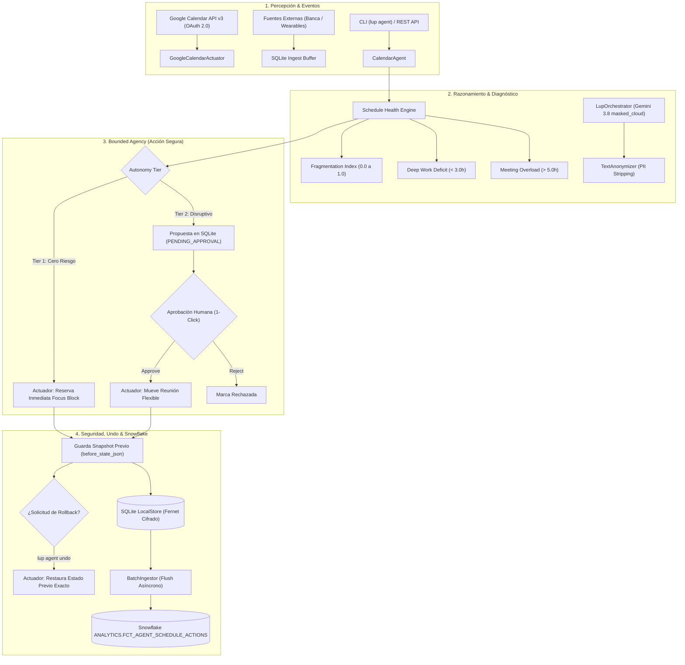

# LUP AI — Autonomous Decision & Calendar Intelligence Platform

[](https://www.python.org/downloads/)
[](https://github.com/astral-sh/ruff)
[]()
[]()
[]()

**LUP AI** es una plataforma de inteligencia de decisiones personales y optimización agéntica de agenda. Transforma datos cotidianos (Finanzas, Hábitos/Sueño y Tiempo/Calendario) almacenados en **Snowflake** y **SQLite** en decisiones cuantificadas, y opera como un **Agente Autónomo de Calendario con Bounded Agency (Agencia Acotada)** capaz de interactuar directamente con Google Calendar API v3 para defender franjas de concentración (*Deep Work*) y resolver fragmentación de agenda con aprobación humana de 1 solo clic y reversibilidad total garantizada (*Snapshot Undo*).

---

## 1. ARQUITECTURA DEL SISTEMA

El sistema opera bajo una arquitectura desacoplada y orientada a la privacidad (*Masked Cloud*):



### Principios Arquitectónicos Clave

1. **Sin capa de IA local pesada:** Toda anonimización PII, validación SQL AST (`SQLGuard`), caché y diagnóstico matemático corre deterministamente en Python y Snowflake.
2. **Capa LLM con Privacidad Absoluta (*Masked Cloud*):** `Gemini 3.8 Flash` procesa únicamente texto sanitizado sin identidades ni credenciales.
3. **Agencia Acotada (Bounded Agency):**
   * **Tier 1 (Autónomo):** El agente reserva franjas de Deep Work en espacios vacíos sin interrumpir al usuario.
   * **Tier 2 (Human-in-the-Loop):** El reacomodo o declinación de reuniones colisionadas se estadifica y requiere confirmación de 1 clic.
4. **Reversibilidad Garantizada (Compensating Snapshot Undo):** Toda mutación guarda el estado íntegro previo; si el usuario lo requiere, la acción se revierte exactamente a su estado anterior.
5. **Persistencia Dual Desacoplada:**
   * **SQLite (`LocalStore`):** Operaciones en milisegundos, almacenamiento cifrado con Fernet de tokens OAuth y cola transaccional.
   * **Snowflake (`LUP_AI_DB`):** Almacén OLAP inmutable de largo plazo. La sincronización se realiza en lotes asíncronos vía `BatchIngestor` mediante sentencias idempotentes `MERGE INTO`, evitando llamadas OLTP costosas a Snowflake.

---

## 2. REQUISITOS PREVIOS

* **Sistema Operativo:** Windows 10/11, macOS o Linux (Ubuntu 22.04+).
* **Python:** Versión **3.12** o superior instalada.
* **Gestor de Paquetes (Recomendado):** `uv` de Astral ([Instalación](https://docs.astral.sh/uv/getting-started/installation/)) o `pip` estándar.
* **Git:** Para control de versiones.
* *(Opcional)* **Google Cloud Console:** Proyecto con Google Calendar API habilitada y archivo `credentials.json` si se desea conectar una cuenta real de Google.
* *(Opcional)* **Snowflake:** Cuenta con permisos para ejecutar DDLs si se desea conectar a la nube (si no se configuran credenciales, el sistema opera con fallback automático a CSVs sintéticos locales).
* *(Opcional)* **Gemini API Key:** Clave de Google AI Studio para consultas en lenguaje natural (`GEMINI_API_KEY`).

---

## 3. PASO A PASO: EJECUCIÓN MANUAL DESDE CERO (`git clone`)

Sigue estos pasos detallados para poner en marcha el sistema completo en una máquina limpia:

### Paso 1: Clonar el Repositorio y Seleccionar la Rama

Abre tu terminal (PowerShell, Bash o Zsh) y ejecuta:

```bash
git clone https://github.com/tu-organizacion/lup-ai.git
cd lup-ai

# Cambiar a la rama oficial del agente de calendario autónomo
git checkout feature/autonomous-calendar-agent
```

*(Si estás trabajando dentro de este workspace local, el directorio raíz del código es `master/martes10nov`)*:
```bash
cd "c:\Users\SEBAS\Desktop\martes 10 nov\master\martes10nov"
```

---

### Paso 2: Crear el Entorno Virtual e Instalar Dependencias

Recomendamos usar **`uv`** por su velocidad extrema y resolución determinista mediante `uv.lock`. Alternativamente, puedes usar `venv` estándar:

#### Opción A: Con `uv` (Recomendado)
```bash
# Crear el entorno virtual con Python 3.12
uv venv --python 3.12

# Activar el entorno virtual:
# En Windows (PowerShell):
.venv\Scripts\Activate.ps1
# En Linux/macOS:
source .venv/bin/activate

# Instalar todas las dependencias (API, Snowflake, LLM, UI, Dev, Calendar):
uv pip install -e ".[api,snowflake,llm,ui,dev,calendar]"
```

#### Opción B: Con `python -m venv` y `pip`
```bash
python -m venv .venv

# Activar el entorno virtual:
# En Windows (PowerShell):
.venv\Scripts\Activate.ps1
# En Linux/macOS:
source .venv/bin/activate

# Instalar el paquete en modo editable con todos los extras:
pip install -e ".[api,snowflake,llm,ui,dev,calendar]"
```

---

### Paso 3: Configurar Variables de Entorno (`.env`)

Copia la plantilla `.env.example` y crea tu archivo local `.env`:

```bash
# En Windows (PowerShell):
Copy-Item .env.example .env

# En Linux/macOS:
cp .env.example .env
```

Edita el archivo `.env`. Para desarrollo local sin Snowflake ni Gemini, los valores por defecto funcionan de inmediato. Si dispones de credenciales reales, configúralas:

```env
LUP_ENV=development
LUP_LOG_LEVEL=INFO
LUP_TIMEZONE=America/Bogota
LUP_PRIVACY_MODE=masked_cloud

# Base de datos local transaccional
LUP_SQLITE_PATH=./data/lup_ai_local.db
LUP_CACHE_TTL_SECONDS=3600

# Clave de cifrado simétrico Fernet para tokens OAuth
LUP_SECRET_KEY=lup-default-fernet-secret-encryption-key-32b

# LLM (Gemini 3.8)
GEMINI_API_KEY=tu_api_key_de_gemini_aqui
GEMINI_MODEL=gemini-3.8-flash

# Snowflake Data Cloud (Opcional, dejar vacío para usar CSVs locales)
SNOWFLAKE_ACCOUNT=
SNOWFLAKE_USER=
SNOWFLAKE_PASSWORD=
SNOWFLAKE_ROLE_AGENT=LUP_AGENT_RO
SNOWFLAKE_ROLE_INGEST=LUP_INGEST_RW
SNOWFLAKE_WAREHOUSE=LUP_WH_XS
SNOWFLAKE_DATABASE=LUP_AI_DB
SNOWFLAKE_SCHEMA_SEMANTIC=SEMANTIC

# Configuración del Agente Autónomo de Calendario
CALENDAR_AGENT_ENABLED=true
CALENDAR_AGENT_CRON_HOURS=7,18
CALENDAR_AGENT_MIN_DEEP_WORK_HOURS=3.0
CALENDAR_AGENT_WORK_START_HOUR=8
CALENDAR_AGENT_WORK_END_HOUR=18
GOOGLE_CALENDAR_CREDENTIALS_PATH=./credentials.json
GOOGLE_CALENDAR_ID=primary
```

---

### Paso 4: Generar Datos Sintéticos y Poblar SQLite Local

Genera 180 días de historial sintético multi-dominio y carga los objetivos personales base en SQLite:

```bash
lup-seed --output-dir data/generated --days 180 --seed 42 --sqlite-path data/lup_ai_local.db
```

Verifica el estado del sistema con el comando de diagnóstico:
```bash
lup status
```
*Salida esperada:*
```text
┌──────────────────────┬──────────────────────────┐
│ Component            │ Value                    │
├──────────────────────┼──────────────────────────┤
│ Privacy Mode         │ masked_cloud             │
│ Data Backend         │ local_synthetic_csv      │
│ Snowflake Configured │ False (o True si hay credenciales) │
│ Gemini 3.8 Configured│ True (si hay GEMINI_API_KEY) │
│ SQLite Path          │ data/lup_ai_local.db     │
└──────────────────────┴──────────────────────────┘
```

---

### Paso 5: Provisionar Snowflake (Opcional)

Si configuraste credenciales de Snowflake en tu `.env`, ejecuta el script de aprovisionamiento DDL (scripts `01` a `06`) y carga de datos:

```bash
# Validar archivos DDL sin conectar (Dry-Run):
lup bootstrap-snowflake --dry-run

# Ejecutar aprovisionamiento real en Snowflake:
lup bootstrap-snowflake
```
*El script creará las tablas `RAW`, `ANALYTICS` (incluyendo `FCT_AGENT_SCHEDULE_ACTIONS`) y vistas seguras en `SEMANTIC`.*

---

### Paso 6: Operar el Agente Autónomo de Calendario (CLI)

El agente dispone de una suite completa de comandos CLI bajo el namespace `lup agent`:

#### 1. Diagnóstico de Salud y Fragmentación de Agenda
Evalúa los próximos 3 días laborales, calculando horas de reuniones, horas de Deep Work disponibles y el índice de fragmentación:
```bash
lup agent health --days 3
```

#### 2. Ejecutar un Ciclo Autónomo del Agente
El agente identifica si hay déficit de Deep Work (< 3.0h) y reserva automáticamente bloques de foco en franjas libres (Tier 1). Si detecta reuniones flexibles en horarios críticos, genera una propuesta de reagendamiento (Tier 2):
```bash
lup agent run --days 3
```

#### 3. Listar Propuestas Pendientes de Aprobación Humana (Tier 2)
```bash
lup agent pending
```

#### 4. Aprobar una Propuesta con 1 Clic
Ejecuta la mutación real en Google Calendar y actualiza el estado a `APPROVED`:
```bash
lup agent approve <action_id>
```

#### 5. Revertir Cualquier Cambio Previsto (1-Click Undo)
Si un bloque de foco o una reunión movida causó algún conflicto, revierte el calendario al estado previo exacto:
```bash
lup agent undo <action_id>
```

---

### Paso 7: Iniciar el Servidor REST FastAPI

Inicia el backend de APIs REST:

```bash
lup serve --host 127.0.0.1 --port 8000
```
* Documentación interactiva Swagger UI: **http://127.0.0.1:8000/docs**
* Endpoint de salud: **http://127.0.0.1:8000/health**

---

### Paso 8: Iniciar el Planificador en Segundo Plano (Scheduler Daemon)

En otra terminal (o como servicio en segundo plano), inicia el motor APScheduler que ejecuta escaneos proactivos, flushes hacia Snowflake y ciclos de calendario a las 07:00 y 18:00:

```bash
# Ejecutar un ciclo único inmediato y salir:
lup scheduler --run-once

# Ejecutar el daemon en segundo plano continuo:
lup scheduler
```

---

### Paso 9: Iniciar la Interfaz Visual Streamlit

En una terminal independiente, levanta la interfaz visual de usuario:

```bash
lup ui --port 8501
```
* Abre tu navegador en: **http://localhost:8501**
* Consume exclusivamente los endpoints de FastAPI (`FastAPI-First architecture`).

---

## 4. REFERENCIA COMPLETA DE COMANDOS CLI

### Comandos del Agente Autónomo de Calendario (`lup agent`)
| Comando | Opciones / Parámetros | Descripción |
| :--- | :--- | :--- |
| `lup agent health` | `--days [int=3]` | Muestra tabla con horas programadas, libres, fragmentación y déficit de foco. |
| `lup agent run` | `--days [int=3]`, `--auto / --dry-run` | Corre el ciclo del agente; defiende bloques de foco y propone reagendamientos. |
| `lup agent pending` | *Ninguna* | Lista propuestas de Nivel 2 esperando confirmación humana. |
| `lup agent approve` | `<action_id>`, `--notes [str]` | Aprueba y ejecuta la reorganización de una reunión en el calendario. |
| `lup agent reject` | `<action_id>`, `--notes [str]` | Descarta una propuesta de reorganización. |
| `lup agent undo` | `<action_id>` | **Reversibilidad total:** Deshace la mutación y restaura el snapshot original. |

### Comandos de Inteligencia y Simulación (`lup`)
| Comando | Opciones / Parámetros | Descripción |
| :--- | :--- | :--- |
| `lup ask` | `"<pregunta>"` | Consulta en lenguaje natural con privacidad PII protegida vía Gemini 3.8. |
| `lup trends` | `--days [int=90]` | Análisis de tendencias y correlaciones de hábitos/finanzas. |
| `lup anomalies` | `--days [int=90]` | Detección determinista de anomalías y oportunidades de mejora. |
| `lup simulate` | `--horizon-days`, `--discretionary-pct`, `--sleep-target` | Simulación What-If determinista proyectada. |
| `lup goals` | *Ninguna* | Lista metas personales activas y avance observado. |
| `lup query` | `<dominio>`, `--days [int=30]` | Consulta directa a las vistas semánticas protegidas. |

### Comandos de Captura de Datos y Sincronización
| Comando | Opciones / Parámetros | Descripción |
| :--- | :--- | :--- |
| `lup capture-finance` | `--amount [float]`, `--category [str]` | Inserta un gasto en el buffer SQLite local. |
| `lup flush` | *Ninguna* | Realiza flush manual del buffer hacia Snowflake o CSV local. |
| `lup sync-simulated` | `--days [int=3]` | Simula ingesta desde APIs bancarias, wearables y calendarios. |

---

## 5. REFERENCIA DE ENDPOINTS DE LA API REST

| Método | Ruta | Esquema Request | Esquema Response | Descripción |
| :--- | :--- | :--- | :--- | :--- |
| `GET` | `/health` | — | `HealthResponse` | Estado de servicios, backend activo y conectividad. |
| `GET` | `/v1/agent/calendar/health` | `days: int = 3` | `list[ScheduleHealthSchema]` | Diagnóstico de fragmentación y balance de agenda. |
| `POST` | `/v1/agent/calendar/cycle` | `AgentCycleRequest` | `AgentCycleResponse` | Dispara el ciclo autónomo de defensa y propuestas. |
| `GET` | `/v1/agent/actions/pending` | — | `list[AgentActionSchema]` | Lista propuestas en espera de aprobación humana. |
| `POST` | `/v1/agent/actions/{id}/approve` | `ActionApprovalRequest` | `AgentActionSchema` | Aprueba y ejecuta una mutación en Google Calendar. |
| `POST` | `/v1/agent/actions/{id}/reject` | `ActionApprovalRequest` | `AgentActionSchema` | Descarta una propuesta agéntica. |
| `POST` | `/v1/agent/actions/{id}/undo` | — | `AgentActionSchema` | **Rollback:** Restaura el evento usando snapshot previo. |
| `POST` | `/v1/agent/oauth/token` | `OAuthTokenSaveRequest` | `dict` | Guarda credenciales OAuth cifradas con Fernet. |
| `POST` | `/v1/ask` | `AskRequest` | `AskResponse` | Inferencia LLM sanitizada pre-prompt. |
| `GET` | `/v1/trends` | `days: int = 90` | `TrendsResponse` | Tendencias deterministas multi-dominio. |
| `GET` | `/v1/anomalies` | `days: int = 90` | `AnomaliesResponse` | Escaneo determinista de anomalías. |
| `POST` | `/v1/simulate` | `SimulateRequest` | `SimulateResponse` | Simulación What-If determinista. |
| `POST` | `/v1/ingest/flush` | — | `FlushResult` | Ejecuta flush por lotes a Snowflake/CSV. |

---

## 6. CONTROL DE CALIDAD, LINTERS Y TESTING

Para garantizar que el código se mantenga limpio y libre de regresiones antes de crear un Pull Request:

### 1. Ejecutar Pruebas Automatizadas (Pytest)
> **Nota de Plataforma (Windows):** Utiliza siempre `--basetemp=.pytest_temp` para evitar errores de permisos en `AppData\Local\Temp`.

```bash
# Con uv:
uv run pytest --basetemp=.pytest_temp -v

# Con venv activo:
pytest --basetemp=.pytest_temp -v
```
*Resultado esperado:* **54 passed in ~28s (100% éxito)**.

### 2. Ejecutar Linters y Formateadores (Ruff)
```bash
# Verificar reglas y tipado estático:
uv run ruff check src tests

# Formatear código según el estándar del repo:
uv run ruff format src tests
```
*Resultado esperado:* `All checks passed!`.

---

## 7. ESTRUCTURA DEL REPOSITORIO

```text
master/martes10nov/
├── snowflake/
│   └── ddl/
│       ├── 01_raw_schema.sql                  # Tablas RAW_FINANCE_TX, RAW_HABITS_SLEEP, RAW_TIME_CALENDAR
│       ├── 02_analytics_dimensions.sql        # Dimensiones DIM_DATE, DIM_CATEGORY, DIM_GOAL
│       ├── 03_analytics_facts.sql             # Tablas de hechos FCT_FINANCE_DAILY, FCT_DECISIONS_LOG
│       ├── 04_semantic_views.sql              # Vistas VW_FINANCE_MONTHLY, VW_CROSS_DOMAIN_DAILY, etc.
│       ├── 05_governance_and_roles.sql        # Roles LUP_AGENT_RO, LUP_INGEST_RW y RBAC
│       └── 06_agent_calendar_actions.sql      # FCT_AGENT_SCHEDULE_ACTIONS y vista semántica
├── src/
│   └── lup_ai/
│       ├── actuators/                         # Efectores del agente en el mundo real
│       │   ├── base.py                        # Protocolo CalendarActuatorProtocol, ActionResult y Enums
│       │   └── google_calendar.py             # GoogleCalendarActuator (API v3, mocks y snapshot undo)
│       ├── agent/                             # Núcleo agéntico
│       │   ├── calendar_agent.py              # Diagnóstico de salud, ciclo autónomo y políticas
│       │   └── orchestrator.py                # Orquestador multi-dominio y consultas LLM
│       ├── api/                               # Capa REST FastAPI
│       │   ├── main.py                        # Definición de rutas, dependencias y lifespan
│       │   └── schemas.py                     # DTOs y modelos Pydantic v2
│       ├── cli/                               # Capa de terminal Typer + Rich
│       │   └── app.py                         # Comandos lup y lup agent
│       ├── config/                            # Configuración tipada
│       │   └── settings.py                    # Pydantic Settings cargadas desde .env
│       ├── connectors/                        # Fuentes externas simuladas
│       │   └── simulated_sources.py           # Conectores de banca, wearables y agenda
│       ├── data/                              # Acceso y persistencia de datos
│       │   ├── batch_ingestor.py              # Ingesta por lotes hacia Snowflake/CSVs
│       │   ├── local_store.py                 # SQLite con cifrado Fernet de credenciales
│       │   ├── snowflake_client.py            # Repositorio analítico Snowflake
│       │   └── sql_guard.py                   # Validador de consultas SQL AST
│       ├── engines/                           # Motores analíticos deterministas
│       │   ├── anomaly_detector.py            # Detección de anomalías
│       │   ├── simulation_engine.py           # Motor de simulación What-If
│       │   └── trend_analyzer.py              # Análisis de tendencias y correlaciones
│       ├── jobs/                              # Tareas en segundo plano
│       │   └── scheduler.py                   # APScheduler daemon (scan, flush y calendar cycle)
│       ├── llm/                               # Clientes LLM
│       │   └── gemini_client.py               # Integración con Google Gemini 3.8
│       ├── memory/                            # Memoria y seguimiento
│       │   └── decision_tracker.py            # Loop de seguimiento y evaluación de impacto
│       ├── privacy/                           # Privacidad y gobernanza
│       │   └── text_anonymizer.py             # Anonimizador determinista pre-LLM
│       ├── seeds/                             # Datos sintéticos y bootstrap
│       │   ├── bootstrap_snowflake.py         # Ejecución secuencial de DDLs en Snowflake
│       │   └── generate_synthetic_data.py     # Generador multi-dominio de 180 días
│       └── ui/                                # Interfaz visual Streamlit
│           ├── api_client.py                  # Cliente HTTP para FastAPI
│           └── streamlit_app.py               # Dashboard interactivo
├── tests/
│   ├── integration/                           # Pruebas de integración E2E
│   │   ├── test_calendar_agent_api.py         # Prueba de ciclo agéntico y batch sync
│   │   ├── test_cli.py                        # Pruebas de comandos CLI
│   │   └── test_orchestrator_and_api.py       # Pruebas de APIs REST principales
│   └── unit/                                  # Pruebas unitarias de componentes
│       ├── test_calendar_agent.py             # Pruebas del cálculo de fragmentación y ciclo
│       ├── test_google_calendar_actuator.py   # Pruebas de actuador, mocks, staging y undo
│       ├── test_bootstrap_snowflake.py        # Pruebas de scripts DDL
│       ├── test_decision_tracker_and_ingest.py# Pruebas de buffer SQLite y flush
│       └── test_sql_guard.py                  # Pruebas de seguridad SQL AST
├── pyproject.toml                             # Configuración de dependencias y empaquetado
└── uv.lock                                    # Lockfile determinista de librerías
```

---

## 8. POLÍTICAS DE CONTRIBUCIÓN Y TRABAJO EN EQUIPO

Para mantener los estándares de calidad definidos por la arquitectura del proyecto:

1. **Estrategia de Ramas:**
   * La rama `main` es sagrada y protegida; solo admite código probado al 100%.
   * Todo nuevo desarrollo debe crearse en una rama feature: `git checkout -b feature/nombre-de-la-feature`.
2. **Guardrails de Ingesta y Snowflake:**
   * **Prohibido realizar llamadas OLTP síncronas a Snowflake dentro de peticiones HTTP de la API.** Toda inserción debe pasar por `BatchIngestor` o el buffer local SQLite.
   * Toda vista semántica nueva debe ser incorporada en `snowflake/ddl/` y declarada en la lista blanca de `sql_guard.py`.
3. **Guardrails Agénticos:**
   * Ningún actuador debe mutar el calendario sin generar antes un token de compensación y guardar el snapshot `before_state_json`.
   * Toda mutación disruptiva (mover/eliminar eventos) debe requerir confirmación humana (Tier 2).
4. **Criterio de Aceptación de Pull Requests (Definition of Done):**
   * Cobertura de pruebas completa para el nuevo módulo.
   * `uv run pytest --basetemp=.pytest_temp` pasando al 100%.
   * `uv run ruff check src tests` con 0 errores.
