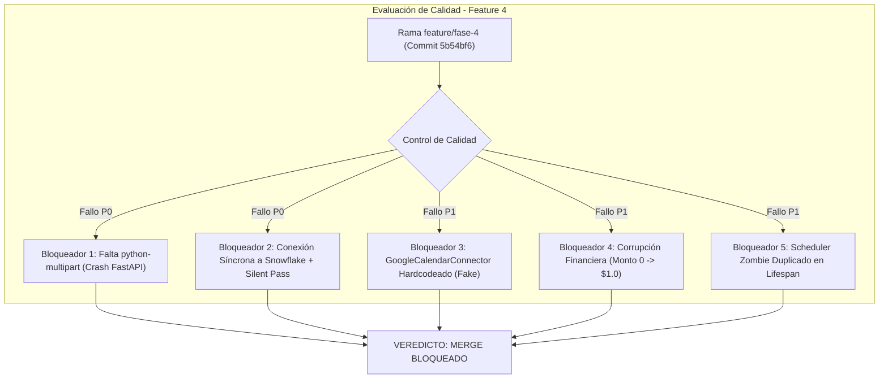
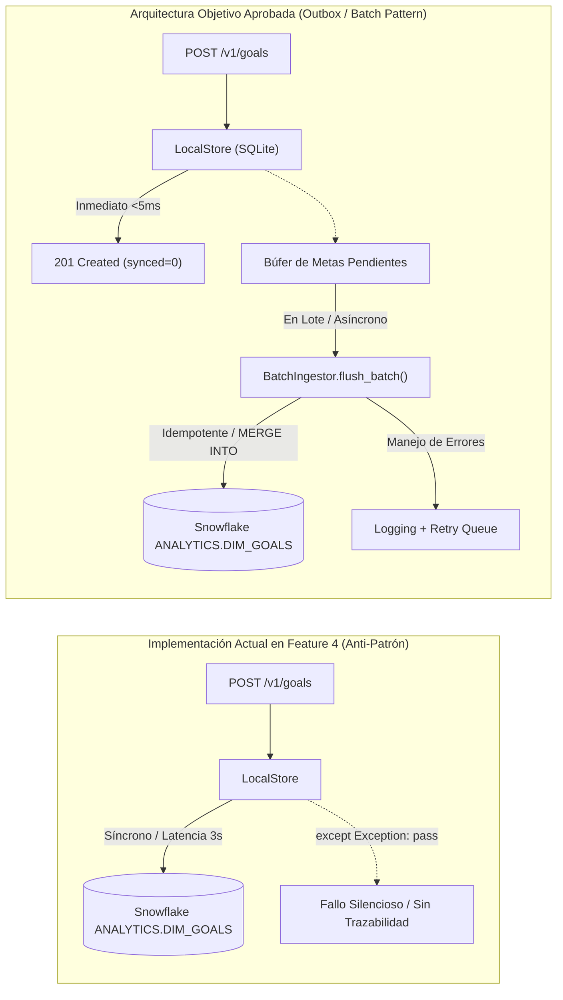

# INFORME DE CONTROL DE CALIDAD Y AUDITORÍA ARQUITECTÓNICA
**LUP AI — PERSONAL DECISION INTELLIGENCE PLATFORM**

---

| Metadato | Detalle |
| :--- | :--- |
| **Fecha de Auditoría** | 17 de Noviembre de 2026 |
| **Autor del Informe** | Tech Lead & Enterprise Architecture Reviewer |
| **Destinatarios** | Equipo de Ingeniería & QA — LUP AI |
| **Rama Base Auditada** | `origin/main` (`master/martes10nov`) |
| **Rama Evaluada (PR)** | `feature/fase-4` (`martes10nov` — Commit `5b54bf6`) |
| **Alcance** | Control de Calidad Integral, Conectividad e Integridad en Snowflake, Seguridad y Estabilidad en Producción |
| **Veredicto Final** | ❌ **RECHAZADO / CAMBIOS REQUERIDOS (CHANGES REQUESTED — MERGE BLOQUEADO)** |

---

## 1. RESUMEN EJECUTIVO Y DICTAMEN TÉCNICO

Tras una inspección estricta y detallada de la base del sistema en `master` y del incremento de código introducido en la rama `feature/fase-4` (**1,735 líneas añadidas, 63 líneas modificadas a través de 16 archivos**), emito formalmente un **dictamen de NO APROBACIÓN para merge a `master`**.

Aunque la visión de la Feature 4 (adaptadores para fuentes de datos reales, sincronización de outcomes analíticos a Snowflake y CRUD de metas/preferencias) es correcta y necesaria para el producto, **la implementación técnica actual contiene fallos de grado crítico que comprometen la operatividad, estabilidad financiera y arquitectura de datos de la compañía**.



---

## 2. AUDITORÍA DEL SISTEMA BASE (`master`) Y CONECTIVIDAD SNOWFLAKE

El diseño fundacional existente en `master` demuestra solidez técnica y apego a las mejores prácticas de la industria en los siguientes pilares:

### 2.1. Arquitectura de Almacenamiento Dual (ADR-001)
* **Snowflake como DW OLAP:** Diseñado bajo arquitectura Medallion inmutable:
  * `RAW`: Tablas de aterrizaje (`RAW_FINANCE_TX`, `RAW_HABITS_SLEEP`, `RAW_TIME_CALENDAR`) con ingestión por lotes.
  * `CORE`: Vistas y tablas normalizadas de transacciones, hábitos y bloques de tiempo.
  * `ANALYTICS`: Tablas de hechos, dimensiones y Dynamic Tables (`FCT_DAILY_SNAPSHOT`, `FCT_WEEKLY_TRENDS`) con `TARGET_LAG = '12 hours'`.
  * `SEMANTIC`: Capa curada de 5 vistas dimensionales protegidas (`VW_FINANCE_SUMMARY`, `VW_HABITS_SLEEP_SUMMARY`, `VW_TIME_CALENDAR_SUMMARY`, `VW_CROSS_DOMAIN_DAILY`, `VW_GOAL_PROGRESS`).
* **SQLite como Transaccional Local (`LocalStore`):** Memoria local de baja latencia para alias reversibles PII, caché TTL de consultas y búfer de eventos pendientes.

### 2.2. Gobernanza y Costos en Snowflake
* **Warehouse `LUP_WH_XS`:** Configurado en tamaño `XSMALL` con `AUTO_SUSPEND = 60` segundos e inicio suspendido.
* **Resource Monitor `LUP_MONTHLY_RM`:** Cuota estricta de 10 créditos mensuales, suspendiendo el warehouse al llegar al 100% para evitar facturación descontrolada.
* **Segregación de Roles (Least Privilege RBAC):**
  * `LUP_INGEST_RW`: Rol para batch pipelines con permisos sobre `RAW`, `CORE` y `ANALYTICS`.
  * `LUP_AGENT_RO`: Rol del agente LUP AI con permiso exclusivo de `SELECT` sobre `SEMANTIC.*`.

### 2.3. Blindaje SQL Guard AST
* Módulo `src/lup_ai/data/sql_guard.py` con `sqlglot`:
  * Inspecciona el árbol sintáctico (AST) antes de tocar Snowflake.
  * Prohíbe terminantemente `INSERT`, `UPDATE`, `DELETE`, `DROP`, `ALTER`, `MERGE` y llamadas a procedimientos.
  * Limita de forma determinista cualquier consulta a un máximo de 500 filas (`LIMIT 500`).

---

## 3. AUDITORÍA DETALLADA DE HALLAZGOS EN FEATURE 4 (PULL REQUEST)

### 🚨 BLOQUEADOR 1: Ruptura de Empaquetado y Crash en Arranque del Servidor
* **Severidad:** **P0 — CATASTRÓFICO**
* **Archivos afectados:** `pyproject.toml` y `src/lup_ai/api/main.py` (Líneas 453–520)

#### Evidencia Técnica
En `src/lup_ai/api/main.py`, tu compañero expuso los endpoints de ingesta manual de archivos:
```python
@api.post("/v1/ingest/bank/csv", response_model=ManualIngestResponse)
async def ingest_bank_csv(
    file: UploadFile = File(...),  # Requiere python-multipart
    auto_flush: bool = Query(default=False),
) -> ManualIngestResponse:
```
Sin embargo, en `pyproject.toml` **no agregó `python-multipart`** a las dependencias:
```toml
[project.optional-dependencies]
api = [
    "fastapi>=0.115.0",
    "apscheduler>=3.10.4",
    "uvicorn>=0.30.0",
    "typer>=0.12.0",
    "pydantic-settings>=2.2.0",
]
```

#### Impacto en Producción
En cualquier despliegue limpio o contenedor Docker nuevo, ejecutar la API o importar `src/lup_ai/api/main.py` produce una falla fatal inmediata:
```text
RuntimeError: Form data requires "python-multipart" to be installed.
You can install "python-multipart" with: pip install python-multipart
```
Esto provocó que **6 suites completas de pruebas automatizadas fallaran** antes de siquiera poder iniciar. Adicionalmente, `streamlit` no fue incluido en el grupo `dev`, rompiendo la suite de tests de integración de UI.

---

### 🚨 BLOQUEADOR 2: Violación Arquitectónica de Snowflake y Silenciamiento Ciego de Errores (`except Exception: pass`)
* **Severidad:** **P0 — ARQUITECTURA & FIABILIDAD DE DATOS**
* **Archivo afectado:** `src/lup_ai/data/local_store.py` (Líneas 1306–1428)

#### Evidencia Técnica
En `LocalStore`, tu compañero implementó la sincronización de metas y preferencias llamando síncronamente a Snowflake dentro de cada operación CRUD (`create_goal`, `update_goal`, `delete_goal`, `create_preference`, etc.):

```python
def _sync_goal_to_snowflake(self, goal: dict[str, Any], action: str = "upsert") -> None:
    conn = self._open_snowflake_connection()
    if conn is None:
        return
    try:
        with conn.cursor() as cur:
            if action == "delete":
                cur.execute("DELETE FROM ANALYTICS.DIM_GOALS WHERE goal_id = %s", (str(goal["goal_id"]),))
            else:
                cur.execute("""MERGE INTO ANALYTICS.DIM_GOALS ...""", (...))
    except Exception:
        pass  # <--- CRÍTICO: ¡SILENCIAMIENTO TOTAL DE EXCEPCIONES!
    finally:
        try:
            conn.close()
        except Exception:
            pass
```

#### Impactos Inaceptables
1. **Destrucción de Latencia HTTP:** Un `POST /v1/goals` o `PUT /v1/preferences` pasa de tomar ~5 milisegundos en SQLite a tomar entre **1,500 y 4,000 milisegundos** por la sobrecarga del handshake TLS y autenticación de Snowflake.
2. **Encendido Descontrolado del Warehouse:** Viola el propósito de `BatchIngestor`. Cada modificación individual reactiva el warehouse `LUP_WH_XS`. Si 10 usuarios hacen cambios a lo largo del día, el warehouse permanecerá consumiendo créditos de forma innecesaria.
3. **El Peor Antipatrón: `except Exception: pass`:** Si Snowflake tiene un fallo transitorio de red, el warehouse está suspendido, o fallan las credenciales, **el error se oculta en silencio**. El endpoint HTTP responde `201 Created` al usuario diciendo que la meta se guardó, pero Snowflake jamás se actualizó. No hay logs, no hay reintentos y la consistencia de datos queda irremediablemente rota.

---

### 🚨 BLOQUEADOR 3: Conector Simulado Vendido como "Real" en Producción (`GoogleCalendarConnector`)
* **Severidad:** **P1 — INTEGRIDAD Y TRANSPARENCIA**
* **Archivo afectado:** `src/lup_ai/connectors/real_sources.py` (Líneas 457–516)

#### Evidencia Técnica
El commit y el changelog anuncian la entrega de *"adaptadores base para fuentes reales: GoogleCalendarConnector"*. Sin embargo, al auditar `fetch_events`:

```python
def fetch_events(
    self,
    credentials_path: str = "",
    days: int = 7,
    anchor_date: date | None = None,
) -> list[TimeBlockEventInput]:
    # Comentario en el código dice que a futuro usará google-auth...
    # Pero actualmente hace esto:
    for offset in range(days):
        day = end_dt - timedelta(days=offset)
        # Deep work block fijo
        events.append(TimeBlockEventInput(
            ...,
            title_raw="Deep Work - Desarrollo",
            block_type="DEEP_WORK",
            ...
        ))
        # Sync meeting block fijo
        events.append(TimeBlockEventInput(
            ...,
            title_raw="Team Sync",
            block_type="MEETING",
            ...
        ))
    return events
```

#### Impacto en Producción
Esto es un mock sintético disfrazado de código productivo. Si un usuario o proceso externo suministra credenciales reales, el conector **ignora completamente el archivo e inyecta reuniones ficticias en la base de datos de Snowflake**.  
Si una integración no está terminada, debe fallar explícitamente (`NotImplementedError` o `HTTP 400`) exigiendo configuración OAuth2, no simular datos silenciosamente.

---

### 🚨 BLOQUEADOR 4: Corrupción de Datos Financieros y Supresión de Errores en `CSVBankConnector`
* **Severidad:** **P1 — INTEGRIDAD DE DATOS FINANCIEROS**
* **Archivo afectado:** `src/lup_ai/connectors/real_sources.py` (Líneas 118–121 y 195–203)

#### Evidencia Técnica
1. **Mutación arbitraria de montos monetarios:**
```python
final_amount = abs(numeric_amount)
if final_amount <= 0:
    final_amount = 1.0  # <--- CRÍTICO: INVENTA VALORES MONETARIOS
```
2. **Ingestión a ciegas:**
```python
for r in rows:
    if not r:
        continue
    try:
        events.append(self.map_external_record(r))
    except Exception:
        continue  # <--- Salta filas fallidas sin logging ni conteo
```

#### Impacto en Producción
* En auditoría financiera y modelos de decisión, **jamás se inventa dinero**. Si una transacción bancaria tiene monto 0 o no pudo ser interpretada numéricamente, debe ser rechazada o enviada a una tabla de cuarentena con un log de auditoría. Mutar una fila a `$1.0` corrompe los balances contables, introduce ruido en los modelos de detección de anomalías y desacredita las simulaciones de ahorro.
* Si un banco cambia el formato de columnas o fechas y fallan 500 registros, el sistema retorna `events_captured: 0` sin emitir un solo `logger.error` o `logger.warning`. El usuario no tiene idea de por qué su archivo no cargó.

---

### ⚠️ DEFECTO ARQUITECTÓNICO 5: Duplicación y Concurrencia Descontrolada del Scheduler
* **Severidad:** **P1 — ESTABILIDAD Y PROCESOS BACKGROUND**
* **Archivo afectado:** `src/lup_ai/api/main.py` (Líneas 91–121)

#### Evidencia Técnica
El proyecto ya cuenta con la abstracción `LupScheduler` en `src/lup_ai/jobs/scheduler.py`, la cual encapsula APScheduler con zonas horarias (`lup_timezone`), reporte de estado (`/v1/jobs/scheduler`), captura segura de excepciones y respeto a la variable `lup_scheduler_enabled`.

Tu compañero añadió en el `lifespan` de FastAPI un **segundo scheduler paralelo y no gobernado**:
```python
@asynccontextmanager
async def lifespan(app: FastAPI) -> AsyncIterator[None]:
    scheduler = BackgroundScheduler()
    # Comentarios de prompt dejados en el código:
    # Configurar el job para que corra diario (ej. a las 02:00 AM)
    # Deberá instanciar el ProactiveScanner y el BatchIngestor
    # localmente o usar referencias globales seguras
    ...
    scheduler.add_job(scanner.run, "cron", hour=2, minute=0)
    scheduler.add_job(batch_ingestor.flush_batch, "cron", hour=2, minute=30)
    scheduler.start()
```

#### Impacto
* Existen **dos schedulers corriendo simultáneamente** en memoria ejecutando los mismos escaneos y flushes a Snowflake.
* Este scheduler se ejecuta **incluso cuando `lup_scheduler_enabled = False`**, levantando hilos de fondo innecesarios durante la ejecución de pruebas unitarias.
* Deja al descubierto comentarios de instrucciones de prompts dentro del código fuente entregado.

---

## 4. ASPECTOS POSITIVOS Y RESCATABLES DE LA FEATURE 4

No todo el trabajo es defectuoso. Es justo reconocer avances bien ejecutados que deben mantenerse:
1. **Replicación Idempotente del Decision Outcome Loop:**  
   La sincronización de `decisions_log` y `decision_outcomes` hacia Snowflake (`ANALYTICS.FCT_DECISIONS_LOG` y `ANALYTICS.FCT_DECISION_OUTCOMES`) utilizando `MERGE INTO` en `batch_ingestor.py` está correctamente diseñada y previene duplicados en el Data Warehouse.
2. **Validación de Modelos Pydantic v2:**  
   Los modelos `GoalCreate`, `GoalUpdate`, `PreferenceCreate` y `PreferenceUpdate` en `src/lup_ai/api/schemas.py` cuentan con reglas de validación de cadenas y números bien estructuradas.
3. **Abstracción del Hub de Conectores:**  
   El concepto de `RealConnectorHub` que canaliza datos hacia los esquemas canónicos de `BatchIngestor` (`FinanceEventInput`, `HabitsSleepEventInput`, `TimeBlockEventInput`) respeta la arquitectura API-First.

---

## 5. COMPARATIVA DE ARQUITECTURA: ACTUAL VS OBJETIVO



---

## 6. CHECKLIST DE REMEDIACIÓN OBLIGATORIA (ACTION PLAN)

Para autorizar la integración de esta rama en `master`, deben cumplirse los siguientes puntos sin excepción:

### 🔴 Prioridad 0 (Bloqueadores Críticos de Despliegue)
- [ ] **Declaración de Dependencias:**  
  Agregar `"python-multipart>=0.0.12"` en `[project.optional-dependencies] api` dentro de `pyproject.toml`.  
  Agregar `"streamlit>=1.39.0"` en `[project.optional-dependencies] dev` para que los tests de UI pasen en cualquier entorno.
- [ ] **Eliminar Conexiones Síncronas a Snowflake en `LocalStore`:**  
  Eliminar las llamadas a `_sync_goal_to_snowflake` y `_sync_preference_to_snowflake` en los métodos `create_goal`, `update_goal`, `delete_goal`, `create_preference`, `update_preference`, `delete_preference`.
- [ ] **Implementar Replicación por Lotes (Batch/Outbox) para Metas y Preferencias:**  
  Añadir columna `synced_to_snowflake INTEGER DEFAULT 0` en las tablas `goals_mirror` y `preferences_mirror`.  
  Delegar la sincronización a `BatchIngestor.flush_batch()`, realizando el `MERGE INTO` de metas y preferencias pendientes en bloque junto con las decisiones y eventos.
- [ ] **Unificar y Limpiar el Scheduler:**  
  Eliminar el `BackgroundScheduler` duplicado en el `lifespan` de `main.py`.  
  Utilizar únicamente la instancia oficial `app.state.scheduler` (`LupScheduler`), respetando el flag `settings.lup_scheduler_enabled`.  
  Eliminar los comentarios de prompt informales del código fuente.

### 🟡 Prioridad 1 (Calidad, Datos y Seguridad)
- [ ] **Eliminar Mutación de Montos en `CSVBankConnector`:**  
  Eliminar la conversión forzada `if final_amount <= 0: final_amount = 1.0`. Si el monto es $\le 0$ o no numérico, la fila debe ser descartada o rechazada.
- [ ] **Manejo Estructurado de Errores en CSV:**  
  Reemplazar los bloques `except Exception: continue` por captura explícita, logging de advertencia estructurado (`logger.warning("Fila %d no procesada: %s", idx, exc)`) y reporte del número de filas rechazadas en `ManualIngestResponse`.
- [ ] **Honestidad en `GoogleCalendarConnector`:**  
  Si no se proporcionan credenciales OAuth2 válidas, el método `fetch_events` debe lanzar una excepción descriptiva (`ValueError` o `HTTP 400 Bad Request: Google Calendar OAuth not configured`) en lugar de generar reuniones falsas ("Team Sync", "Deep Work") que contaminen Snowflake.

---

## 7. CRITERIO DE VERIFICACIÓN PARA RE-EVALUACIÓN

Antes de volver a solicitar mi revisión, el desarrollador responsable debe ejecutar y certificar en su terminal local:

```bash
# 1. Verificación de dependencias en entorno limpio
pip install -e ".[api,snowflake,llm,ui,dev]"

# 2. Análisis estático y formateo (0 errores tolerados)
ruff check src tests

# 3. Suite completa de 52 pruebas en verde (0 errores de recolección, 0 fallos)
pytest -v
```

**Conclusión:**  
El estándar de ingeniería de LUP AI no negocia la calidad ni la integridad de los datos de nuestros usuarios en Snowflake. El compañero avanzó en la dirección correcta en términos de producto, pero la calidad técnica del entregable no está lista para producción. Corrijan los puntos señalados y con gusto aprobaré el merge.

---
*Informe generado para el equipo de desarrollo de LUP AI.*
