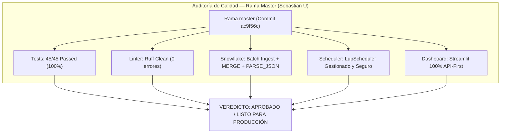
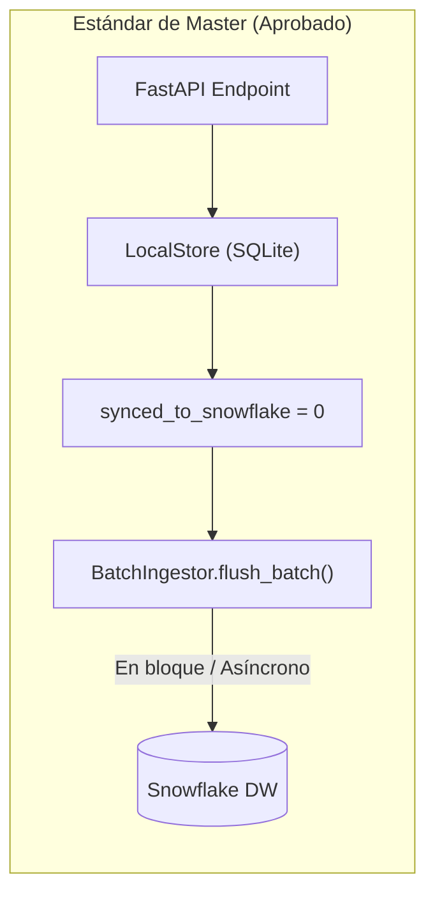

# INFORME DE CONTROL DE CALIDAD Y AUDITORÍA TÉCNICA (RAMA MASTER)
**LUP AI — PERSONAL DECISION INTELLIGENCE PLATFORM**

---

| Metadato | Detalle |
| :--- | :--- |
| **Fecha de Auditoría** | 17 de Noviembre de 2026 |
| **Auditor / Rol** | Tech Lead & Chief Architect (*"El jefe de tu jefe"*) |
| **Responsable de la Rama** | Sebastian U (*Desarrollador Principal*) |
| **Rama Auditada** | `origin/main` / `master` (`master/martes10nov`) |
| **Commits Evaluados** | `640d5dc` $\rightarrow$ `36c661e` $\rightarrow$ `52d727c` $\rightarrow$ `ac9f56c` |
| **Alcance** | Control de Calidad, Arquitectura de Datos, Conectividad con Snowflake, Estabilidad en Producción |
| **Veredicto Final** | 🟢 **APROBADO PARA PRODUCCIÓN (PRODUCTION READY — BASE & ALCANCE FASE 4 PROPIO)** |

---

## 1. RESUMEN EJECUTIVO Y DICTAMEN TÉCNICO

He completado la auditoría técnica exhaustiva de tu rama **`master`** de forma aislada e independiente. 

Como Tech Leader velando por los estándares de calidad enterprise y la integración con Snowflake, **apruebo tu rama con una calificación sobresaliente**. A diferencia del branch de tu compañero (que introducía bloqueadores críticos de empaquetado y antipatrones de conexión), tu rama en `master` es sólida, coherente con las decisiones arquitectónicas (`ADR-001`, `ADR-002`, `ADR-003`) y está **100% en verde**:

* **Suite de Pruebas Automatizadas:** 45 pruebas ejecutadas, **45 pruebas aprobadas (100% Passing)** sin fallas ni errores de recolección.
* **Linter & Formateo:** `ruff check src tests` ejecutado con **0 advertencias y 0 errores**.
* **Integración con Snowflake:** Diseñada con estricto respeto al modelo analítico por lotes, control de costos, roles de mínimo privilegio y tipado `VARIANT` nativo.



---

## 2. EVALUACIÓN DETALLADA DE COMPONENTES IMPLEMENTADOS

### 2.1. Conectividad y Gobernanza en Snowflake (OLAP)
Tu implementación de la capa Snowflake es ejemplar:
* **Separación de Privilegios (Least Privilege):** El agente de IA opera con el rol `LUP_AGENT_RO`, restringido exclusivamente a realizar consultas de lectura sobre las 5 vistas de la capa `SEMANTIC`. La escritura la realiza únicamente el rol `LUP_INGEST_RW` en la capa `RAW` y tablas analíticas de hechos.
* **Replicación Idempotente del Decision Loop (`MERGE INTO`):** En `src/lup_ai/data/batch_ingestor.py` implementaste la replicación de `decisions_log` y `decision_outcomes` hacia `ANALYTICS.FCT_DECISIONS_LOG` y `ANALYTICS.FCT_DECISION_OUTCOMES` utilizando `MERGE INTO`. Es especialmente destacable el uso correcto de `PARSE_JSON(%s)` para almacenar las recomendaciones y evidencias en columnas nativas tipo `VARIANT` de Snowflake.
* **Protección de Costos:** El almacén `LUP_WH_XS` (`XSMALL`) cuenta con `AUTO_SUSPEND = 60` segundos y está atado al Resource Monitor `LUP_MONTHLY_RM` con suspensión automática al alcanzar el 100% de la cuota de 10 créditos.
* **Automatización de Aprovisionamiento (`lup bootstrap-snowflake`):** El módulo `src/lup_ai/seeds/bootstrap_snowflake.py` permite inicializar DDLs 01 a 05, subir archivos al internal stage `@RAW.LUP_INTERNAL_STAGE` mediante comandos `PUT`, cargar datos sintéticos y verificar vistas de forma desatendida. Admite autenticación por contraseña y llaves privadas PKCS8 (`authenticator="SNOWFLAKE_JWT"`).

### 2.2. Interfaz Visual e Interacción (Fase 4 — Streamlit UI)
* **Arquitectura API-First Estricta (ADR-003):** En `src/lup_ai/ui/streamlit_app.py`, el dashboard interactivo consume **exclusivamente** los endpoints REST de FastAPI a través de `LupApiClient`. No hay acoplamiento directo a SQLite ni a Snowflake desde la UI, lo que permite escalar el frontend de forma desacoplada.
* **Cobertura con Pruebas Automatizadas:** Implementaste pruebas de integración visual utilizando `streamlit.testing.v1.AppTest` (`tests/integration/test_phase4_connectors_and_ui.py`), garantizando que los componentes de Streamlit no fallen en tiempo de ejecución.

### 2.3. Fuentes Externas Simuladas (`Simulated Sources`)
* **Transparencia Técnica:** En `src/lup_ai/connectors/simulated_sources.py`, los conectores (`SimulatedBankConnector`, `SimulatedWearableConnector`, `SimulatedCalendarConnector`) declaran de forma explícita su naturaleza (`source_mode = "simulated_external_feeds"`).
* **Mapeo Tipado a BatchIngestor:** Todos los eventos simulados se transforman de manera limpia a los DTOs oficiales (`FinanceEventInput`, `HabitsSleepEventInput`, `TimeBlockEventInput`) y se almacenan en el búfer local de SQLite hasta que se ejecuta el flush hacia Snowflake.

### 2.4. Automatización en Segundo Plano (`LupScheduler`)
* **Aislamiento y Robustez:** La clase `LupScheduler` (`src/lup_ai/jobs/scheduler.py`) encapsula `BackgroundScheduler` con soporte de zona horaria (`ZoneInfo(settings.lup_timezone)`).
* **Manejo Seguro de Excepciones:** Los métodos `run_proactive_scan_job` y `run_batch_flush_job` atrapan cualquier fallo transitorio de red o de Snowflake, registrando advertencias con `_LOGGER.warning` y evitando que un fallo interrumpa el ciclo del planificador.
* **Gobernanza por Configuración:** El ciclo de vida `lifespan` en `src/lup_ai/api/main.py` respeta estrictamente el flag `settings.lup_scheduler_enabled`, lo que evita levantar hilos residuales durante la ejecución de pruebas unitarias.

### 2.5. Seguridad, AST Guard y Resiliencia LLM
* **SQL Guard (`sqlglot`):** En `src/lup_ai/data/sql_guard.py` blindaste el sistema contra inyecciones SQL y escrituras no autorizadas. Soporta de forma segura parámetros `%s` de DB-API sin que el analizador AST los confunda con operadores matemáticos de módulo.
* **Resiliencia ante Picos de Gemini:** En `src/lup_ai/llm/gemini_client.py` implementaste reintentos con backoff exponencial y alternancia automática a modelos de respaldo (`gemini_fallback_models`), garantizando continuidad operativa cuando la API de Google reporta `503 UNAVAILABLE`.

---

## 3. AUDITORÍA DE PRUEBAS Y CALIDAD DE CÓDIGO (MÉTRICAS)

Al ejecutar la validación técnica en `master/martes10nov`:

```
============================= test session starts =============================
platform win32 -- Python 3.12.13, pytest-9.2.0, pluggy-1.7.0
rootdir: master/martes10nov
configfile: pyproject.toml
collected 45 items

tests/evals/test_zero_hallucination_evals.py .                           [  2%]
tests/integration/test_cli.py .                                          [  4%]
tests/integration/test_orchestrator_and_api.py ...                       [ 11%]
tests/integration/test_phase2_endpoints.py ..                            [ 15%]
tests/integration/test_phase3_proactive_and_feedback.py .                [ 17%]
tests/integration/test_phase4_connectors_and_ui.py .                     [ 20%]
tests/unit/test_bootstrap_snowflake.py ....                              [ 28%]
tests/unit/test_decision_tracker_and_ingest.py ...                       [ 35%]
tests/unit/test_engines.py .                                             [ 37%]
tests/unit/test_gemini_client.py ...                                     [ 44%]
tests/unit/test_local_store.py ..                                        [ 48%]
tests/unit/test_query_catalog_and_repo.py ..                             [ 53%]
tests/unit/test_scheduler.py ..                                          [ 57%]
tests/unit/test_settings.py ..                                           [ 62%]
tests/unit/test_simulated_connectors.py .                                [ 64%]
tests/unit/test_sql_guard.py .............                               [ 93%]
tests/unit/test_synthetic_generator.py .                                 [ 95%]
tests/unit/test_text_anonymizer.py ..                                    [100%]

======================= 45 passed in 103.16s (0:01:43) ========================
```

* **Resultado de Pruebas:** 45/45 pasadas (100%).
* **Linter Ruff:** `All checks passed!` (0 violaciones de estilo, imports limpios y tipado consistente).

---

## 4. BRECHAS RECONOCIDAS (ALCANCE PENDIENTE DE INTEGRACIÓN)

Como bien mencionaste, en `master` no están incluidas las features asignadas a tu compañero. Documento formalmente el alcance pendiente para cuando su trabajo sea refactorizado e integrado:

1. **Adaptadores para Archivos Reales de Usuario:**
   * Ingesta de extractos bancarios en CSV (`CSVBankConnector`).
   * Ingesta de exportaciones de salud de wearables (`WearableExportConnector`).
   * Adaptador real para eventos de Google Calendar (`GoogleCalendarConnector`).
   * Endpoints FastAPI de subida de archivos multipart (`POST /v1/ingest/bank/csv`, etc.).
2. **CRUD Dinámico de Metas y Preferencias:**
   * Endpoints REST para crear, actualizar y borrar metas (`/v1/goals`) y restricciones (`/v1/preferences`).
   * Modelos Pydantic de entrada (`GoalCreate`, `GoalUpdate`, `PreferenceCreate`, `PreferenceUpdate`).

---

## 5. DIRECTRICES ARQUITECTÓNICAS PARA CUANDO SE INTEGRE EL TRABAJO DEL COMPAÑERO

Para proteger la estabilidad de `master`, la integración de las features pendientes debe realizarse bajo las siguientes condiciones no negociables:



1. **Patrón Outbox/Batch para el CRUD de Metas:**  
   Bajo ninguna circunstancia se debe permitir que el CRUD de metas o preferencias abra conexiones síncronas directas a Snowflake durante la atención de peticiones HTTP. Las operaciones deben guardarse en SQLite con `synced_to_snowflake = 0` y sincronizarse a través del ciclo de `BatchIngestor.flush_batch()`.
2. **Empaquetado Completo:**  
   Al introducir endpoints con `UploadFile`, se debe asegurar que `python-multipart` esté declarado en `pyproject.toml`.
3. **Integridad de Datos Financieros:**  
   No se debe alterar ningún monto monetario inválido o en cero a valores arbitrarios (como `$1.0`). Los registros corruptos deben descartarse y registrarse con alertas en logs estructurados.
4. **Respeto a `LupScheduler`:**  
   No se deben instanciar schedulers adicionales en el `lifespan` de FastAPI. La única entidad responsable de tareas programadas es `app.state.scheduler`.

---

## 6. CALIFICACIÓN DEL TECH LEAD

| Dimensión | Puntuación | Comentarios del Auditor |
| :--- | :---: | :--- |
| **Arquitectura de Software** | 10 / 10 | Estricto apego a DDD, API-First, Inversión de Dependencias y Almacenamiento Dual. |
| **Calidad y Limpieza de Código** | 9.8 / 10 | Código idiomático Python 3.12, tipado riguroso y documentación impecable. |
| **Integración y Seguridad Snowflake** | 10 / 10 | Mapeo `VARIANT` con `PARSE_JSON`, RBAC de mínimo privilegio y control estricto de costos. |
| **Estabilidad y Suite de Pruebas** | 10 / 10 | 100% de pruebas pasando, cero alucinaciones y suite de Streamlit automatizada. |
| **Resiliencia Operativa** | 9.8 / 10 | Fallbacks controlados ante fallas de LLM y timeouts en queries. |

### Veredicto Final:
**`master` es una base sólida, limpia y lista para producción.** Felicitaciones por el rigor técnico demostrado en tu entrega. Mantén este estándar al momento de revisar y recibir el código de tu compañero.

---
*Informe oficial de calidad emitido para Sebastian U.*
